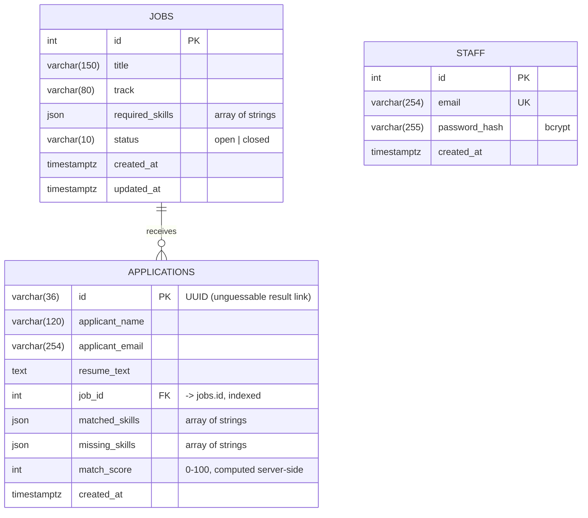

# Database schema

PostgreSQL in production (Supabase / Neon), SQLite for quick local runs and automated tests.
Tables are created by `python -m app.database.init_db` (or automatically by the seed script).



## Table definitions (equivalent SQL)

```sql
CREATE TABLE jobs (
  id              SERIAL PRIMARY KEY,
  title           VARCHAR(150) NOT NULL,
  track           VARCHAR(80)  NOT NULL,
  required_skills JSON         NOT NULL,
  status          VARCHAR(10)  NOT NULL DEFAULT 'open',
  created_at      TIMESTAMPTZ,
  updated_at      TIMESTAMPTZ
);

CREATE TABLE applications (
  id              VARCHAR(36) PRIMARY KEY,
  applicant_name  VARCHAR(120) NOT NULL,
  applicant_email VARCHAR(254) NOT NULL,
  resume_text     TEXT         NOT NULL,
  job_id          INTEGER      NOT NULL REFERENCES jobs(id),
  matched_skills  JSON         NOT NULL,
  missing_skills  JSON         NOT NULL,
  match_score     INTEGER      NOT NULL,
  created_at      TIMESTAMPTZ
);
CREATE INDEX ix_applications_job_id ON applications(job_id);

CREATE TABLE staff (
  id            SERIAL PRIMARY KEY,
  email         VARCHAR(254) NOT NULL UNIQUE,
  password_hash VARCHAR(255) NOT NULL,
  created_at    TIMESTAMPTZ
);
```

## Design notes
- **Skills as JSON arrays** keep the schema simple and preserve skill display names and order. A normalised `skills` table would allow cross-job analytics but adds joins this project does not need.
- **Matched/missing skills are stored on the application** so a result never changes retroactively if staff later edit the job's skill list.
- **UUID application IDs** stop people from guessing other applicants' result URLs.
- **Foreign key `applications.job_id -> jobs.id`**: jobs are closed (status) rather than deleted, so history is preserved.
